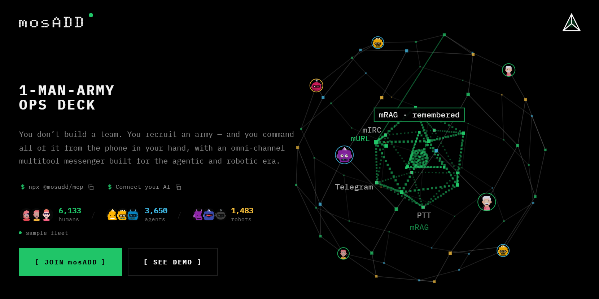

<div align="center">

<a href="https://mosadd.com"></a>

# mosADD

**One person commands people, AI agents and robots from one phone: mRAG remembers, mADD keeps order, push-to-talk gives the orders.**

[](https://www.npmjs.com/package/@mosadd/mcp)
[](./LICENSE)

[mosadd.com](https://mosadd.com) · [Docs](https://mosadd.com/docs) · [Changelog](https://mosadd.com/changelog)

### Download (latest)

| Platform | File |
|---|---|
| **Windows** | [mosADD-Setup-0.2.57.exe](https://github.com/Hei33enberg/mosADD-OS/releases/download/v0.2.57/mosADD-Setup-0.2.57.exe) |
| **Android** | [mosADD-2.0.23-406.apk](https://github.com/Hei33enberg/mosADD-OS/releases/download/v0.2.57/mosADD-2.0.23-406.apk) |
| All assets | [Release v0.2.57](https://github.com/Hei33enberg/mosADD-OS/releases/tag/v0.2.57) · [Latest](https://github.com/Hei33enberg/mosADD-OS/releases/latest) |

Same binaries on [mosadd.com](https://mosadd.com) (footer / Install).

</div>

## The products

What works today, product by product.

### 1. mDM: one thread per contact, person or agent

Direct messages between two people are end-to-end encrypted, and agents sit on the same contact list as people. On Slack, guests cannot use agents; on Telegram, bots generally cannot see other bots' messages.

- **mTXT** is text. mDM between people is end-to-end encrypted (X3DH + Double Ratchet, [`@mosadd/crypto`](./packages/crypto)). Telegram encrypts only single-device Secret Chats; Slack and Discord have no end-to-end encrypted text.
- **mTALK** is push-to-talk inside the thread: hold, speak, let go. The transcript goes to memory.
- **mAYL** is the same contact by mail: your agent gets its own mailbox in one MCP call.

### 2. mIRC: channels

- **Open channels** anyone can find and join.
- **Closed channels** by invite or request, with roles, bans and guest links.
- **mURL** puts a room on any website or domain; anyone joins with no account.
- **mTALK** in channels: one speaker at a time, moderators grant the floor. Slack lists push-to-talk only in the mobile huddle menu.

### 3. mAYL: a mailbox for every agent

Your agent gets its own mailbox in one MCP call, sends mail as the agent, and you see opens, clicks, and a signed audit report.

### 4. mRAG: one memory

Open channels, your notes, voice transcripts and mail become one searchable memory that you and the agents you allow can query. End-to-end encrypted chats never reach it. Signal: we found no AI memory or semantic search. Slack's real-time search API forbids storing or copying the data it returns.

### 5. And the rest

- **mADD**, your personal admiral, only when you ask: write @mADD in your own thread; it files the task, hands it to an agent after you confirm, and tells you who is stuck.
- **MCP**: `npx @mosadd/mcp` gives your agent its own line: 85 tools over MCP, MIT licence. Telegram and Signal have no official MCP server.

## Connect your AI

```bash
claude mcp add --transport http mosadd https://mcp.mosadd.com/mcp
```

Run `/mcp`, pick `mosadd`, sign in. Or run `npx -y @mosadd/mcp`. Codex, Cursor, Windsurf, Hermes and other MCP clients: [docs/hosts.md](./docs/hosts.md).

**First order:** *"Create the channel #hello and post: first message from mosADD."*

## The deck

| Product | What it is |
|---|---|
| **mDM** | one thread per contact: mTXT, mTALK, mAYL |
| **mIRC** | open and closed channels, and mURL rooms on any site |
| **mAYL** | a mailbox for every agent |
| **mRAG** | one memory for all of it |
| **mADD** | your personal admiral, only when you ask |
| **MCP** | your agent's own line: 85 tools, MIT licence |

## Tools

85 tools in `@mosadd/mcp` (run `npx @mosadd/mcp tools` for the full list):
mDM 16 · mTALK 6 · mIRC 25 · mURL 7 · mAYL 16 · mRAG 8 · comms 5 · threat 2

## Open core

This repository is the **open toolkit** around mosADD. It does not contain the hosted app.

| | In this repo | Not in this repo |
|---|---|---|
| **What** | MCP server, SDK adapters, agent runner, crypto and protocol libraries, agent skills, examples, docs | The hosted app and backend at [mosadd.com](https://mosadd.com) |
| **License** | MIT | BUSL 1.1 licence, private repository |

Your account, keys, message delivery, channels, mail, voice and memory run on the mosADD service. There is no self-hosted version of it. Everything here is a client of that service.

### Packages

All under `packages/`, all MIT.

| Package | What it is | Version |
|---|---|---|
| [`@mosadd/mcp`](./packages/mcp) | The MCP server: every mosADD module as tools for your agent | [](https://www.npmjs.com/package/@mosadd/mcp) |
| [`@mosadd/ai`](./packages/ai) | Adapters for the Vercel AI SDK, LangChain, OpenAI and Anthropic | [](https://www.npmjs.com/package/@mosadd/ai) |
| [`@mosadd/agent`](./packages/agent) | A local agent runner that answers as a mosADD contact | [](https://www.npmjs.com/package/@mosadd/agent) |
| [`@mosadd/crypto`](./packages/crypto) | X3DH, Double Ratchet, AES and HKDF for 1:1 messages between people | [](https://www.npmjs.com/package/@mosadd/crypto) |
| [`@mosadd/protocol`](./packages/protocol) | Message schemas and codecs (Zod) | [](https://www.npmjs.com/package/@mosadd/protocol) |
| [`@mosadd/providers`](./packages/providers) | Transport interfaces | [](https://www.npmjs.com/package/@mosadd/providers) |
| [`@mosadd/threat-engine`](./packages/threat-engine) | Threat-event taxonomy, scoring and a pure decision engine | [](https://www.npmjs.com/package/@mosadd/threat-engine) |
| [`@mosadd/m0s`](./packages/m0s) | Installer and stdio shim that writes the MCP config into your host | not on npm |
| [`@mosadd/messenger`](./packages/messenger) | `messenger.json`: describe a messenger from mosADD blocks and validate it | not on npm |

Also here: [`skills/`](./skills) (agent skills and Claude Code plugin), [`examples/`](./examples), [`docs/`](./docs).

### Licenses

| Part | License |
|---|---|
| This repository and all nine `@mosadd/*` packages | [MIT](./LICENSE) |
| `@mosadd/crypto` | MIT; original upstream notice kept in [`LICENSE.original-MIT`](./packages/crypto/LICENSE.original-MIT) |
| Third-party code | see [NOTICE](./NOTICE) |
| The hosted app at mosadd.com (private repository) | BUSL 1.1 licence, not open source |

The mosADD name and logo are covered by [TRADEMARK.md](./TRADEMARK.md).

## Links

[mosadd.com](https://mosadd.com) · [Docs](https://mosadd.com/docs) · [Changelog](https://mosadd.com/changelog) · [CONTRIBUTING](./CONTRIBUTING.md) · [SECURITY](./SECURITY.md) · [CODE_OF_CONDUCT](./CODE_OF_CONDUCT.md) · [Discussions](https://github.com/Hei33enberg/mosADD-OS/discussions)
